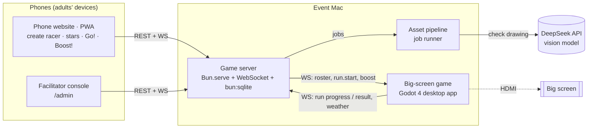

# BebbiKart — Project Overview

**Status:** Working plan, v0.2 (2026-10-30)
**Spirit:** This is a **one-time game for one event**. Build it fast; spend the effort on **game feel and smoothness**, not on robustness. No load testing, QA process, edge-case hardening or disaster recovery. If something breaks on the day, the facilitator reloads the page.
**Supersedes:** the parts of `../bebbikart_codex_game_brief.md` that describe one kart at a time with no phone app. That brief is still the reference for the toy-world look, course beats, abilities and weather (§2, §4, §6, §8).

This folder splits BebbiKart into workstreams that can be built **in parallel** by different people or coding agents. The shared rules sit in [`contracts.md`](contracts.md). Every workstream builds against it, so the work can start without waiting on the others.

| Doc                                                              | What it covers                                                                                                                  |
| ---------------------------------------------------------------- | ------------------------------------------------------------------------------------------------------------------------------- |
| [`contracts.md`](contracts.md)                                   | Data model, REST API, WebSocket messages, asset package format, IDs and enums. **Read this first.**                             |
| [`workstreams/game-server.md`](workstreams/game-server.md)       | WS2: Bun server, the realtime hub between phones and the big screen, persistence, run admission, leaderboard                    |
| [`workstreams/game.md`](workstreams/game.md)                     | WS3: The 3D big-screen game: world, course, autopilot, weather, cameras, HUD                                                    |
| [`workstreams/phone-app.md`](workstreams/phone-app.md)           | WS4: Phone **website (PWA, no native app)** for creating a racer, tuning stars and launching runs, plus the facilitator console |
| [`workstreams/asset-pipeline.md`](workstreams/asset-pipeline.md) | WS5: DeepSeek looks at raw drawings and writes a 3D racer design (JSON) that the game builds and animates                       |
| [`workstreams/event-setup.md`](workstreams/event-setup.md)       | WS6: Mac + screen + local Wi-Fi setup, one rehearsal                                                                            |

---

## 1. The game in one paragraph

Kids draw a **character** and a **vehicle** on paper. The vehicle can be anything: a kart, a bicycle, a horse, a rocket shoe. A supervising adult photographs both drawings with a phone, using a simple web page opened from a QR code or a short URL. The server checks that the photos are drawings on paper and not real photos. AI then captures the drawing's spirit and colours and designs a 3D toy racer from it, which the game builds and brings to life with poses, facial expressions and a phone avatar, and the racer appears in a colourful 3D toy world shown on a **big screen** in the meeting room. During a **~30-minute session**, every racer tries to set the **fastest time** on one short course. **The computer drives.** Kids are the coaches: between runs they spread **10 stars** across six abilities, pick a route at each of three forks and set a driving style, then press **Go!** on the phone. During a run they time **Boost!** taps to glowing boost zones. After each run they see section-by-section times against their best, so they can tell exactly where they lost time. Many racers share the course at once, each with their own timer, and they **bump into each other**, so no two runs play out the same. Random **rain and wind** keep the world lively. Best times climb a live leaderboard, and at the end of the session the top three get a podium.

## 2. Game rules (the source of truth for all workstreams)

1. **Session.** A facilitator starts a session (default **30 min**, configurable). The session clock is shown on the big screen. When it ends, no new runs start, runs on the course finish, and the podium shows.
2. **Racers.** Up to **20 connected racers** (configurable `maxPlayers`). One racer per phone/browser by default. The facilitator can create racers for kids without a device (see phone-app doc).
3. **Presence.** A racer is shown in the **paddock** strip on the big screen while their phone is connected. Runs can only be launched from a connected device or by the facilitator.
4. **Build.** Before each run a kid sets:
   - **Stars:** exactly **10**, 0–5 per ability, across `speed`, `jump`, `grip`, `water`, `stability`, `bounce` (meaning and trade-offs: brief §6).
   - **Routes:** one choice at each of **three forks**: the **pond** (`water` shortcut / `bridge`), the **big ramp** (`jump` over / `around`), the **windy crossing** (`exposed` fast bridge / `sheltered` hedge path). The best choice depends on the build _and_ the weather.
   - **Driving style:** `careful` / `balanced` / `daring`. This changes how fast the autopilot takes corners and how early it brakes. Daring is faster but slips more.
5. **Run.** Pressing **Go!** puts the racer on the start grid and starts a **3-second countdown** (`startCountdownMs`) on the big screen and the phone; everyone who presses Go before the lights go green leaves together, so a group really races each other (contracts §2c). The course takes up to `maxConcurrentRuns` (default 20) at once. A per-run timer starts at the line. The autopilot drives. A clean run on a sensible build takes **~20–40 s**.
6. **Boost.** Each run has **3 boosts** (`boostsPerRun`, set 0 to disable). The track has glowing **boost zones**. Tapping Boost while on a zone gives a **perfect boost**: strong and stable. Tapping anywhere else gives a weaker boost that also cuts grip for a moment, so it can cause a slip on a wet bend or a wobble mid-air in wind. Timing is the skill.
7. **Learning tools.** These turn "try again" into "get better":
   - **Section splits.** The course has four timed sections: `hills`, `pond`, `crossing`, `bends`. After a run the phone shows each section's time compared with the racer's best: green if faster, red if slower. It also gives one **coach tip** aimed at the biggest loss, e.g. "Lost 3 s at the pond. Try the bridge, or +1 water."
   - **Best-run ghost.** A see-through copy of the racer's own best run drives next to them. Phone and big screen show "+1.2 s / −0.8 s vs your best" at each section line.
   - **Weather warning.** About **5 s before** rain or wind starts, the world shows it coming (clouds gather, leaves swirl) and phones show "Rain coming!" Kids can wait to launch, or launch anyway with a build ready for it.
8. **Fail.** Off track, flipped, stuck for 3 s, or past the 90 s time cap → the run fails with a friendly "oops" and a one-line hint. **No checkpoints**: the next run starts from the start line.
9. **Finish.** The run time is measured in **simulation time** (fixed-timestep ticks, not wall clock), so frame drops can't change results. A finished run updates the racer's personal best and the leaderboard.
10. **One run at a time per racer.** A racer can't launch again until their current run ends.
11. **Racers collide.** Everyone on the course is solid: racers bump, push and knock each other off line. This is deliberate. It adds entropy so runs aren't predictable, and it makes crowd timing part of the strategy: launch into a busy track and risk bumps, or wait for a quiet moment. Heavier builds (`stability`) push others and get pushed less. Bumps are comic, never damaging. Only the racer's own **best-run ghost** is see-through and doesn't collide (it's a replay).
12. **Ranking.** The leaderboard ranks each racer's **best finished time**. Ties go to whoever set it first.
13. **Weather** is global world state, random and independent of runs (brief §8). It is never frozen or equalised for fairness.
14. **Vehicle type is cosmetic.** A horse and a kart with the same stars drive the same way. Only the look and animation differ. This keeps it fair and keeps the asset pipeline simple.

## 3. Architecture



**Key decisions (defaults; change them here if you disagree):**

- **Server, phone site and asset pipeline: plain JavaScript (ES modules, no TypeScript) on [Bun](https://bun.sh)**, in one Bun-workspaces monorepo. The contracts are shared code for these (zod schemas + constants in `packages/shared`). Bun gives us a fast runtime with SQLite, WebSockets, multipart uploads and package management built in. **Why not Rust:** 20 phones on a LAN is a trivial load for any server, and Rust would cost development speed for no visible gain.
- **Big-screen game: [Godot 4](https://godotengine.org) (GDScript), as a native macOS app** on the event Mac. It gives us an editor for the world, lighting, particles and cameras, and native performance, which is where smoothness actually comes from. It only talks to the server through the WebSocket messages and asset URLs in `contracts.md`.
- **The phone side is a website, not an app.** It is a **Progressive Web App**: opened from a QR code or URL, installable to the home screen if wanted, nothing to download from a store.
- **Local network only, plain HTTP.** Phones open `http://<mac-ip>:8080` from the QR code. No domain or certificate in V1. Because browsers only allow offline caching and app install over HTTPS, those PWA extras wait until we add HTTPS after the first version.
- **The big-screen game owns the simulation.** It runs physics, autopilot, weather and timing, and reports results to the server. The server never simulates. This avoids networked physics.
- **The server is the hub and the record keeper.** It holds players, builds, assets, runs, leaderboard and session clock, and relays messages between phones and the game.
- **Local first.** Server and game run on one Mac on the local network. Internet is only needed for the DeepSeek call.
- **Racers are real 3D toys designed by AI.** DeepSeek looks at the raw drawings and writes a small JSON design (`RacerSpec`): which toy parts, the drawing's colours, the face, plus extra shapes for unique details. The Godot game builds the racer in 3D from a toy-part kit and animates it (drive, boost, jump, dizzy, oops, celebrate, wave, facial expressions). The game also renders avatar pictures for the phone. One DeepSeek call per racer, no image generation.

**Repo layout (created in M0):**

```
bebbikart/
  packages/shared/        # zod schemas, message defs, config defaults        (WS1)
  apps/server/            # game server + job runner host                      (WS2)
  apps/game/              # big-screen game, Godot 4 project                   (WS3)
  apps/web/               # phone app + /admin console                         (WS4)
  packages/asset-pipeline/# drawing → RacerSpec designer, with CLI           (WS5)
  docs/
```

## 4. Workstreams and how they connect

| WS  | Name                                      | Can start                                             | Builds against (until the real thing exists)         |
| --- | ----------------------------------------- | ----------------------------------------------------- | ---------------------------------------------------- |
| WS1 | Foundations & contracts                   | **Now (first, small)**                                | Nothing, it _is_ the contract                        |
| WS2 | Game server                               | After M0                                              | The game's mock mode, the phone app, a stub pipeline |
| WS3 | Big-screen game (Godot)                   | **Now** (world, course and sim don't need the server) | Built-in `--mock` mode that fakes the server         |
| WS4 | Phone website (PWA) & facilitator console | After M0 (UI mock-ups can start now)                  | Mock API (MSW) generated from contracts              |
| WS5 | Asset pipeline                            | **Now** (CLI on sample drawings)                      | Its own CLI; no server needed                        |
| WS6 | Event setup                               | Now (venue/network questions)                         | Nothing                                              |

WS1 is small, about 1–2 days for one person. Everyone else should **agree on and review `contracts.md` before M0 closes**, because changing a contract later costs every stream.

## 5. Milestones

| Milestone                | What "done" means                                                                                                                                                                                                                                      |
| ------------------------ | ------------------------------------------------------------------------------------------------------------------------------------------------------------------------------------------------------------------------------------------------------ |
| **M0 Foundations**       | Repo skeleton builds; `packages/shared` exports every type, schema and message in `contracts.md`; mock helpers exist; each app runs a hello-world.                                                                                                     |
| **M1 Parallel slices**   | Each stream works alone against mocks: game drives 20 fake racers on a grey-box course; server handles phones and the game by hand-testing; phone app clicks through all screens on the mock API; pipeline CLI turns 20 sample drawings into packages. |
| **M2 First end-to-end**  | A real phone creates a racer from two photos → the racer appears in the paddock → Go! → the run is shown on the big screen → the time appears on the phone and leaderboard.                                                                            |
| **M3 Content & balance** | Full toy course, rain and wind, all six abilities tuned, boost tuned, hints, podium; playtested with colleagues (and kids if possible).                                                                                                                |
| **M4 Event ready**       | One rehearsal on the real Mac, screen and Wi-Fi with a handful of real phones.                                                                                                                                                                         |

The event date isn't set yet. Plan M4 for a few days before it.

## 6. Open decisions (defaults chosen so work isn't blocked)

| Question                                                                                         | Default in these docs                                                                                                             |
| ------------------------------------------------------------------------------------------------ | --------------------------------------------------------------------------------------------------------------------------------- |
| Boost button during runs?                                                                        | On, 3 per run, configurable to 0                                                                                                  |
| One phone = one racer, or one adult phone for several kids?                                      | **Decided: one phone = one racer.** The facilitator console can still create and launch racers for kids without a phone.          |
| Session length                                                                                   | 30 min, configurable                                                                                                              |
| Max racers / concurrent runs                                                                     | 20 / 20                                                                                                                           |
| Event hardware, screen, network                                                                  | **Decided:** server and game run on **one Mac**; the big screen is any display plugged into it; phones join over the local Wi-Fi. |
| Is sending drawing photos to DeepSeek's API OK under the company's data rules?                   | Assumed yes (drawings only, no faces, metadata stripped). **Needs a yes from the company.**                                       |
| Age range of kids                                                                                | Unknown. UI is written for ~6–12 with an adult helping.                                                                           |
| How racers are made                                                                              | **Decided:** DeepSeek writes a 3D design (JSON), the game builds it from a toy-part kit. No image generation.                     |
| Progression (collectible stickers, cosmetic unlocks for finishing runs or beating section times) | V2. Must stay cosmetic so the leaderboard stays fair.                                                                             |

## 7. Out of scope for V1

Manual steering, combat, online play or accounts, multiple courses, procedural worlds, ML driving, generated 3D meshes, tablets as a separate controller type (phones already cover it).
